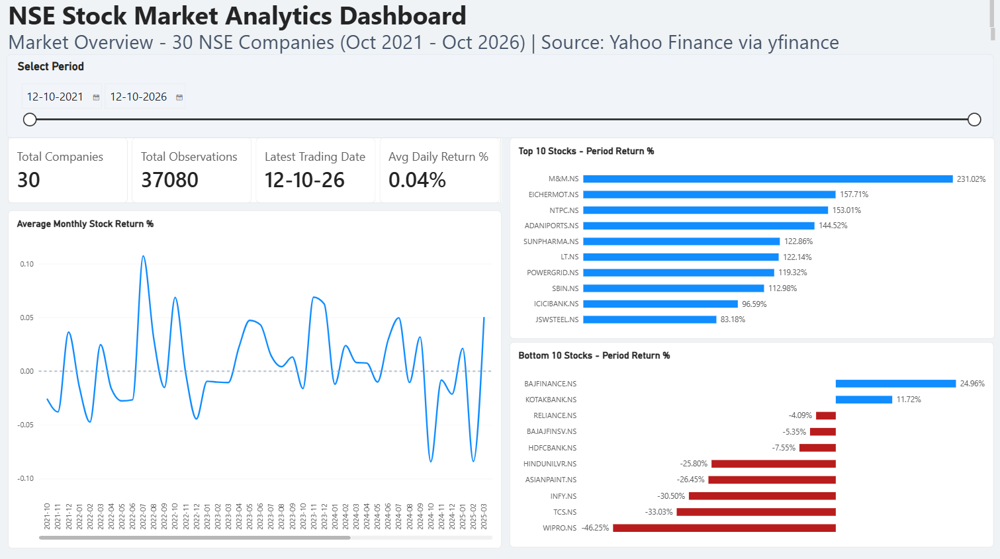
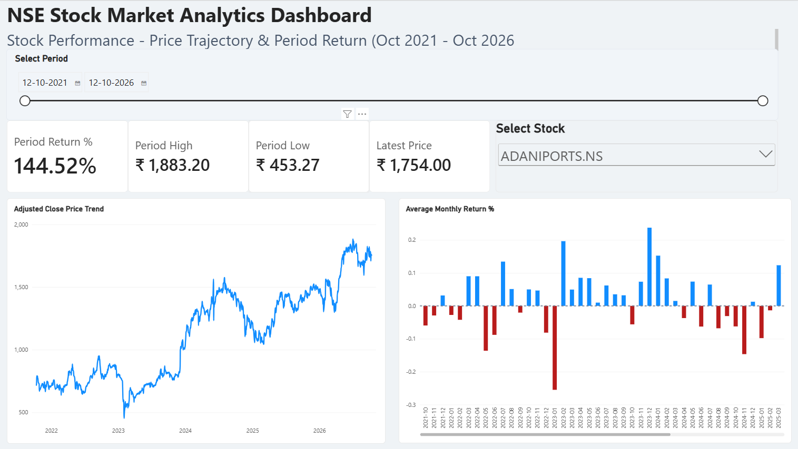
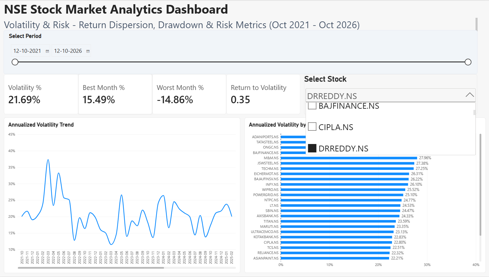
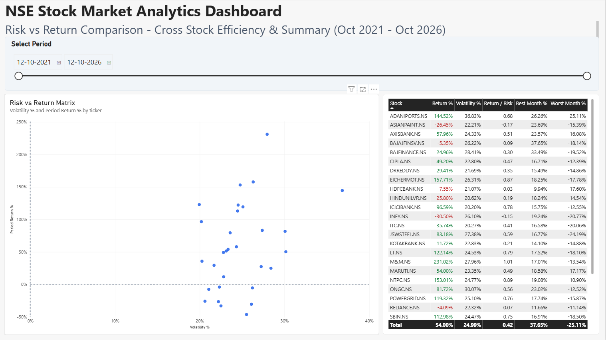

# NSE Equity Risk & Return Analytics Suite

An end-to-end data analytics project analysing the historical performance and risk characteristics of 30 companies listed on the National Stock Exchange (NSE) of India. The project uses Python, Pandas, PostgreSQL, SQL and Power BI to collect, process, analyse and visualise five years of historical stock market data.

## Project Overview

This project examines historical stock performance across 30 NSE-listed companies over a five-year period, from **12 October 2021 to 12 October 2026**.

The workflow covers data extraction and transformation in Python, database storage and analysis using PostgreSQL, and interactive visualisation through Power BI.

### Dataset at a Glance

| Attribute | Details |
|---|---|
| Market | National Stock Exchange of India (NSE) |
| Companies | 30 |
| Time Period | 12 October 2021 – 12 October 2026 |
| Frequency | Daily |
| Total Observations | 37,080 |
| Data Source | Yahoo Finance via yfinance |
| Primary Price Metric | Adjusted Closing Price |

## Technologies Used

- **Python:** Data extraction and preprocessing
- **Pandas:** Data manipulation and financial calculations
- **yfinance:** Historical stock market data retrieval
- **PostgreSQL:** Data storage and querying
- **SQL:** Data validation and financial analysis
- **Power BI:** Interactive dashboards and visualisation

## Project Workflow

1. **Data Extraction:** Historical stock data for 30 NSE-listed companies is retrieved using Python and yfinance.
2. **Data Processing:** Pandas is used to clean and transform the data and calculate financial metrics.
3. **Database Storage:** Processed data is exported to CSV and imported into PostgreSQL.
4. **SQL Analysis:** SQL queries are used for data validation, stock performance analysis, volatility analysis and monthly performance calculations.
5. **Visualisation:** PostgreSQL data is connected to Power BI to build interactive analytical dashboards.

## Financial Metrics

The project calculates and analyses the following metrics:

- **Daily Returns:** Percentage change in adjusted closing prices.
- **Cumulative Returns:** Total percentage appreciation or depreciation relative to the first available adjusted closing price in the dataset.
- **Annualised Volatility:** Rolling standard deviation of daily returns, annualised using the square root of 252 trading days.
- **Compounded Monthly Returns:** Monthly returns calculated by compounding daily returns.
- **Risk and Performance Comparison:** Comparison of stocks based on historical returns and volatility.

## SQL Analysis

The SQL scripts cover the following areas:

| Script | Purpose |
|---|---|
| `00_create_table.sql` | Creates the `stock_prices` table |
| `01_data_validation.sql` | Validates the imported dataset |
| `02_top_performers.sql` | Analyses top-performing stocks |
| `03_worst_performers.sql` | Analyses worst-performing stocks |
| `04_volatility_analysis.sql` | Examines stock volatility |
| `05_monthly_performance.sql` | Analyses monthly stock performance |
| `06_compounded_monthly_returns.sql` | Calculates compounded monthly returns |

## Power BI Dashboard

The Power BI dashboard is organised into four analytical pages:

1. **Market Overview:** Overall market and dataset-level performance.
2. **Stock Performance:** Comparison of historical stock returns and performance.
3. **Risk & Volatility:** Analysis and comparison of stock volatility.
4. **Monthly Analysis:** Monthly performance trends and comparisons.

### Dashboard Screenshots

**1. Market Overview**



**2. Stock Performance**



**3. Risk & Volatility**



**4. Monthly Analysis**



The complete Power BI files are available in the `powerbi` folder.

## Repository Structure

NSE-Equity-Risk-Return-Analytics/
|
|-- README.md
|
|-- python/
|   |-- fetch_nse_data.py
|   |-- python_dependencies.txt
|
|-- sql/
|   |-- 00_create_table.sql
|   |-- 01_data_validation.sql
|   |-- 02_top_performers.sql
|   |-- 03_worst_performers.sql
|   |-- 04_volatility_analysis.sql
|   |-- 05_monthly_performance.sql
|   |-- 06_compounded_monthly_returns.sql
|
|-- powerbi/
|   |-- Nse_Stock_Market_Analytics_Dashboard.pdf
|   |-- Nse_Stock_Market_Analytics_Dashboard.pbix
|
|-- Screenshots/
|   |-- Screenshot_1.png
|   |-- Screenshot_2.png
|   |-- Screenshot_3.png
|   |-- Screenshot_4.png
|
|-- archive_v1/
    |-- Previous version files
    
## How to Reproduce the Project

### 1. Clone the Repository

```bash
git clone <repository-url>
cd NSE-Stock-Market-Analytics/V2-Advanced-Analytics
```

### 2. Install Python Dependencies

```bash
pip install -r python/python_dependencies.txt
```

### 3. Generate the Dataset

Run the Python script:

```bash
python python/fetch_nse_data.py
```

This retrieves the historical data, processes it and generates the CSV dataset.

### 4. Set Up PostgreSQL

- Create a PostgreSQL database named `nse_analytics`.
- Open the SQL Query Tool in pgAdmin.
- Execute `sql/00_create_table.sql` to create the `stock_prices` table.
- Import the generated CSV dataset into the table, ensuring that CSV columns are mapped to the corresponding database columns.
- Execute the remaining SQL scripts to perform the analyses.

### 5. Open the Power BI Dashboard

Open:

`powerbi/Nse_Stock_Market_Analytics_Dashboard.pbix`

If recreating the project on another computer, update the PostgreSQL connection details in Power BI as required.

## Data Validation

The imported dataset was checked for:

- Missing values in the original stock price fields.
- Duplicate ticker-date combinations.
- Expected missing daily returns at the beginning of each stock's time series.
- Expected missing rolling volatility values during the initial rolling calculation period.

The final imported dataset contains **37,080 observations across 30 companies**.

## Previous Version

The `archive_v1` folder contains the initial version of this project, featuring an earlier implementation and dashboard.

This is the current and more comprehensive implementation , which expands the analysis to 30 NSE-listed companies and includes Python-based data processing, PostgreSQL integration, SQL analysis and a four-page Power BI dashboard.

## Limitations

- Historical data is sourced through Yahoo Finance using the yfinance Python library; it is not a direct feed from the NSE.
- The analysis uses historical data and does not provide live market prices.
- Historical returns and volatility do not guarantee future performance.
- The dataset covers the specified five-year observation period and should not be interpreted as a real-time market representation.

## Project Objective

The objective of this project is to demonstrate an end-to-end data analytics workflow, combining Python-based data processing, relational database management, SQL-based analysis and Power BI visualisation to derive insights from historical financial market data.
